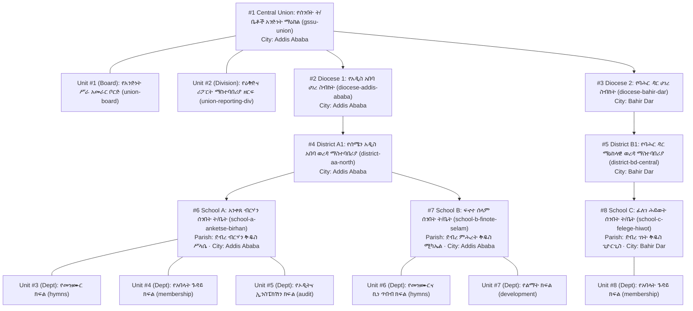

# Autonomous Overnight Hierarchy & Access Completion Report — TASK-027

- **Task ID:** `TASK-027` (completing `TASK-024` + Union Super Administrator extension + extension-review security corrections + hierarchy milestone localization)
- **Date:** 14 November 2026 (`Africa/Addis_Ababa`)
- **Implementing Agent:** Antigravity (Gemini)
- **Implementation Status:** `In review`
- **Manual Acceptance Status:** `Pending` (owner has not yet performed morning manual verification of this batch)

---

## 1. Completed Scope vs. Deferred Scope

### Completed in This Batch (`TASK-027`)
1. **Reviewer Finding 1 Resolved (High — Technical user editor takeover of business identities):**
   - Hardened `App\Policies\UserPolicy` (`update`, `delete`) and `App\Http\Controllers\Admin\UserManagementController` (`edit`, `update`, `updateRoles`, `destroy`) with target-aware business-identity checks (`$user->hasBusinessIdentity()`).
   - Technical operators (`tech-admin@example.test` / `Admin` role) can no longer open the edit page (`GET /admin/users/{user}/edit`), change passwords/emails/names/locales (`PUT /admin/users/{user}`), modify roles (`PUT /admin/users/{user}/roles`), or delete (`DELETE /admin/users/{user}`) any account that holds a business appointment or Sunday School membership.
   - Blocked attempts return `403` and record an explicit audit event (`users.business-edit-denied`, `users.business-takeover-denied`, `users.business-role-grant-denied`, `users.business-delete-denied`).
   - Updated `/admin/users` UI (`resources/js/pages/admin/Users/Index.vue` and `resources/js/types/admin.ts`) to display a `Protected Business Identity` badge and hide edit/delete actions on business accounts, while keeping backend enforcement authoritative.
   - Preserved account-owner self-service for profile (`PATCH /settings/profile`) and password (`PUT /settings/password`, requiring `current_password`), while blocking self-deletion (`DELETE /settings/profile`) of protected demo/appointed accounts (`403` + `users.protected-self-delete-denied`).
2. **Reviewer Finding 2 Resolved (High — Durable technical/business appointment incompatibility):**
   - Added durable identity helpers on `App\Models\User`:
     - `hasTechnicalIdentity(): bool` — checks `scoped_appointments` where `role_key = 'technical_operator'` (both active and inactive history) in addition to `roles()->exists()`.
     - `hasBusinessIdentity(): bool` — checks non-technical `scoped_appointments` (active or inactive) in addition to `schoolMemberships()->exists()`.
   - Enforced incompatibility in `App\Models\ScopedAppointment::assertValidScopeAndDates()` (model `saving` hook) and in `App\Http\Controllers\HierarchyDemoController` (`hierarchyIndex`, `storeLocalLeadAppointment`, `showSchool`, `storeDepartmentCoordinatorAppointment`), recording `appointments.technical-incompatibility-denied` in `ActivityLogger`. Removing a technical user's global Spatie role can no longer make them eligible for a business appointment.
3. **Self-Review & Hardening of Inherited Surfaces:**
   - **Global Search (`App\Http\Controllers\GlobalSearchController`):** Excluded business accounts (users with non-technical appointments or school memberships) from technical user search results.
   - **Exports (`App\Http\Controllers\ExportCenterController`):** Scoped user exports (`CSV`/`XLSX`/`XML`/print/PDF) to exclude business accounts, and excluded private local school events (`member-profile.updated`, `memberships.approved`, `reports.submitted-local`, `departments.created`) from technical activity-log exports.
   - **Activity Logs (`App\Http\Controllers\ActivityLogController` & `DashboardController`):** Filtered private local school/member/draft events out of technical activity log listings and dashboard recent activity.
   - **Organization Hierarchy Rules (`App\Support\HierarchyScopeContext::canCreateOrganizationUnder` & `HierarchyDemoController::updateOrganization`):** Validated parent-child organization type rules (`union -> diocese`, `diocese -> district|sunday_school`, `district -> sunday_school`) and prevented deactivating the root `union` organization.
4. **Bilingual Catalogue Completion (`am` Default, `en` Selectable) Across the Hierarchy Milestone & Account Settings:**
   - Expanded `lang/am/messages.php` and `lang/en/messages.php` with full keys for `settings.*` (`security`, `appearance`, `delete_account`) and `demo.*` (`types`, `unit_kinds`, `categories`, `statuses`, `roles`, `role_summaries`, `dashboard`, `hierarchy`, `national_summary`, `org_update`, `lead_appointments`, `coordinator_appointments`, `school`, `department`, `member`, `my_profile`, `reports`, `permissions`).
   - Replaced remaining inline bilingual strings and raw status/type/category codes across all 8 hierarchy/demo Vue pages (`Dashboard.vue`, `hierarchy/Index.vue`, `schools/Show.vue`, `departments/Show.vue`, `members/Show.vue`, `members/MyProfile.vue`, `reports/Index.vue`, `reports/Show.vue`) and the account settings pages (`settings/Security.vue`, `settings/Appearance.vue`, `components/DeleteUser.vue`, `components/AppearanceTabs.vue`).
   - Reference entities (organizations, internal units, appointment titles) prefer `nameEn`/`titleEn` when `locale === 'en'` with fallback to `nameAm`/`titleAm`, while personal/member/report content (`fullName`, `serviceNotes`, `titleAm`, `summaryAm`) is always rendered and saved verbatim in UTF-8.
5. **Idempotent Demo Seeder Preservation (`database/seeders/HierarchyAccessDemoSeeder.php`):**
   - Updated `HierarchyAccessDemoSeeder` to use `firstOrCreate` on organizations, units, appointments, people, school memberships, department memberships, and demo reports, and to preserve existing user `name`, `locale`, and `password` values on rerun so owner manual testing changes are never silently overwritten.

### Deferred Scope (Not Implemented in This Milestone)
- **Production Account-Recovery Governance:** A dual-control or local-lead/union-verified password recovery workflow for locked-out business users remains a future governance task; in this milestone, technical operators are strictly denied direct credential/email mutation of business accounts.
- **Full Entity Lifecycle & Destructive Deletion:** Hard deletion of organizations, units, people, memberships, and reports is intentionally omitted; deactivation (`is_active` / `status`) is used instead.
- **Remaining Inherited Admin Screens (`TASK-018`):** Inherited technical administration pages (`/admin/users`, `/admin/roles`, `/admin/settings`, `/admin/activity-logs`, `/admin/media`, `/admin/exports`) and guest password-reset/2FA modals remain primarily English as recorded in `docs/requirements/language-and-data.md`.
- **Production Modules (`TASK-010`–`TASK-020`):** Full membership registration/onboarding workflows, configurable assigned forms (`TASK-011`), activity attendance (`TASK-013`), reporting templates (`TASK-014`), and inter-school shared spaces (`TASK-016`) remain planned backlog items.

---

## 2. Both Reviewer Findings & How Each Is Fixed

| Finding | Risk Identified in `2026-11-14-task-024-extension-review.md` | Exact Backend Fix & Verification Path |
|---|---|---|
| **Finding 1 (High): Technical user editor can take over business identities** | `UserPolicy::update()` checked only `users.update`. Because `tech-admin@example.test` has `Admin` (`users.update`, `users.delete`), `PUT /admin/users/{user}` accepted `email` and `password` mutations on `union-admin@example.test` (`#11`) and `lead-a@example.test` (`#1`). | 1. Added `User::hasBusinessIdentity()` checking non-technical `scoped_appointments` (active or inactive) and `school_memberships`.<br>2. Updated `UserPolicy::update()` and `UserPolicy::delete()` to return `false` whenever `$model->hasBusinessIdentity()` is true (unless updating own self-service profile).<br>3. Updated `UserManagementController::edit()`, `update()`, `updateRoles()`, and `destroy()` to log `users.business-edit-denied`, `users.business-takeover-denied`, `users.business-role-grant-denied`, or `users.business-delete-denied` and `abort(403)` before any mutation.<br>4. Verified via CLI policy check: `$tech->can('update', $union)` -> `DENY`, `$tech->can('update', $leadA)` -> `DENY`, `$tech->can('delete', $leadA)` -> `DENY`. |
| **Finding 2 (High): Business appointment exclusion relies on mutable global roles** | `HierarchyDemoController` checked `$targetUser->roles()->exists()` when appointing a Sunday School Lead or Department Coordinator. If a technical operator's global Spatie role were removed first, they could be granted `school_lead` or `department_coordinator`. | 1. Added `User::hasTechnicalIdentity()` checking `scoped_appointments` where `role_key = 'technical_operator'` (regardless of `is_active` or dates) in addition to `roles()->exists()`.<br>2. Enforced `! $targetUser->hasTechnicalIdentity()` for all business appointments and `! $targetUser->hasBusinessIdentity()` for `technical_operator` appointments inside `ScopedAppointment::assertValidScopeAndDates()` (model `saving` hook) AND inside `HierarchyDemoController::storeLocalLeadAppointment()` and `storeDepartmentCoordinatorAppointment()`, logging `appointments.technical-incompatibility-denied`.<br>3. Filtered `appointableUsers` and `coordinatorCandidates` queries with `whereDoesntHave('scopedAppointments', fn ($q) => $q->where('role_key', 'technical_operator'))`. |

---

## 3. Hierarchy Diagram (Authority vs. Internal Units vs. Geography)



---

## 4. All 11 Fictional Demo Accounts & Local Credentials File

- **Git-Ignored Credentials Files (Verified via `git check-ignore -v`):**
  - Markdown table: `storage/app/private/demo-credentials.md`
  - JSON map: `storage/app/private/demo-credentials.json`
  - *Note: Passwords are preserved unchanged from initial seeding and are never printed in tracked files or chat.*

| User ID | Email (`@example.test`) | Default Locale | Role Key / Persona | Assigned Scope & Purpose |
|---|---|---|---|---|
| `#11` | `union-admin@example.test` | `am` | `union_super_admin` (Main Comparison #1) | Central Union (`#1` `gssu-union`) — Nationwide hierarchy, org create/update, local-lead appointments, released reports & national summary; **denied** private member directories & unreleased drafts |
| `#1` | `lead-a@example.test` | `am` | `school_lead` (Main Comparison #2) + 2nd scope `district_officer` | School A (`#6`) Local Lead [switchable to District A1 (`#4`) via Safe Scope Switcher] |
| `#10` | `tech-admin@example.test` | `am` | `technical_operator` (Main Comparison #3) | Platform Technical Operator (`Admin` Spatie role + `technical_operator` appointment) — **denied** private school workspaces and **denied** editing/deleting business accounts |
| `#2` | `lead-b@example.test` | `am` | `school_lead` | School B (`#7`) Local Lead — same city (Addis Ababa) and same District (`#4`) as School A, proving horizontal isolation |
| `#3` | `coord-hymns-a@example.test` | `am` | `department_coordinator` | School A — Hymns Department (`Unit #3`) Coordinator |
| `#4` | `member-a@example.test` | `am` | `approved_member` | School A — Approved Member (`Membership #1`, assigned to Hymns `#3` and Membership `#4`) |
| `#5` | `pending-a@example.test` | `am` | `pending_member` | School A — Pending Member Applicant (`Membership #2`, awaiting Lead A approval) |
| `#6` | `district-aa-north@example.test` | `am` | `district_officer` | District A1 (`#4` North Addis Ababa) — oversees Schools A & B released reports and completeness |
| `#7` | `diocese-aa@example.test` | `am` | `diocese_officer` | Diocese 1 (`#2` Addis Ababa) — oversees District A1 & Schools A/B; can register subordinate orgs under Diocese 1 / District A1 |
| `#8` | `union-reporting@example.test` | `am` | `union_division_coordinator` | Central Union — Planning & Reporting Division (`Unit #2`, `reporting_coordination` functional filter) |
| `#9` | `union-board@example.test` | `en` | `union_board_member` | Central Union — Governing Board (`Unit #1`, explicit `en` locale preference) |

*(In addition, `SchoolMembership #3` `SSU-A-003` represents `ማርታ ገብሩ`, an approved School A member without a login account, and `SchoolMembership #4` `SSU-B-001` represents `ሳሙኤል ታደሰ`, an approved School B member.)*

---

## 5. Allowed vs. Denied Access Matrix (Routes, Record IDs & Direct Requests)

| Persona / Account | Allowed Actions & Routes (`200` / `302`) | Denied Direct-URL & Request Scenarios (`403` / `422`) |
|---|---|---|
| **Union Super Administrator**<br>`union-admin@example.test` | • `GET /dashboard` (national summary card)<br>• `GET /hierarchy` (all 8 orgs)<br>• `POST /hierarchy/organizations` (create diocese/district/school)<br>• `PUT /hierarchy/organizations/{1..8}` (update org details)<br>• `POST /hierarchy/appointments` (appoint non-technical user as `school_lead`)<br>• `PATCH /appointments/{2,4}` (activate/deactivate `school_lead` appointment)<br>• `GET /schools/6`, `/schools/7`, `/schools/8` (summary & released reports only; member directory hidden)<br>• `GET /reports` & `GET /reports/{1,4,6}` (released reports + completeness) | • `GET /members/1`, `/members/2`, `/members/3`, `/members/4` -> `403`<br>• `GET /departments/3`, `/departments/4` -> `403`<br>• `POST /memberships/2/approve` -> `403`<br>• `POST /schools/6/departments` -> `403`<br>• `POST /schools/6/appointments` -> `403`<br>• `GET /reports/2` (School A draft), `/reports/3` (School A submitted_local), `/reports/5` (School B draft) -> `403`<br>• `POST /reports/3/release` -> `403`<br>• `POST /hierarchy/appointments` with `user_id=10` (`tech-admin`) -> `422` + audit `appointments.technical-incompatibility-denied`<br>• `GET /admin/users`, `GET /admin/settings` -> `403` |
| **Sunday School Lead (School A)**<br>`lead-a@example.test`<br>*(Active scope: School A Lead)* | • `GET /schools/6` (full workspace + private member directory + coordinator appointments)<br>• `GET /departments/{3,4,5}` (all School A departments)<br>• `GET /members/{1,2,3}` (School A members)<br>• `POST /memberships/2/approve` (approve Pending Member A)<br>• `POST /schools/6/departments` (create department in School A)<br>• `POST /schools/6/appointments` (assign School A member as `department_coordinator`)<br>• `GET /reports/{1,2,3,4}` & `POST /reports/3/release` (release report upward)<br>• `POST /workspace/scope` (`scope_key=appointment:3` to switch to District A1 scope) | • `GET /schools/7` (School B in same city/district) or `GET /schools/8` (School C) -> `403`<br>• `GET /departments/{6,7,8}` (School B/C departments) -> `403`<br>• `GET /members/4` (School B member) -> `403`<br>• `GET /reports/5` (School B draft) or `GET /reports/6` (School C released) -> `403`<br>• `PUT /hierarchy/organizations/6` -> `403`<br>• `POST /hierarchy/appointments` -> `403`<br>• `POST /schools/6/appointments` with `role_key=union_super_admin` -> `403`<br>• `GET /admin/users` -> `403` |
| **Sunday School Lead (School A)**<br>`lead-a@example.test`<br>*(Switched to 2nd scope: District A1 Officer)* | • `GET /hierarchy` (District A1 & Schools A/B in jurisdiction)<br>• `GET /schools/6`, `GET /schools/7` (summary only; School A private member directory is **hidden** while in District scope!)<br>• `GET /reports` (released reports `#1`, `#4` and District A1 completeness) | • `GET /members/1` (even though Lead A can view it in School A scope, it is denied `403` while in District A1 scope — no privilege combination!)<br>• `POST /memberships/2/approve` -> `403`<br>• `GET /reports/2`, `GET /reports/3` (School A drafts) -> `403` |
| **Department Coordinator (School A Hymns)**<br>`coord-hymns-a@example.test` | • `GET /departments/3` (Hymns Dept members & reports `#1`, `#2`)<br>• `GET /members/1`, `GET /members/3` (members in Hymns Dept)<br>• `GET /reports/1`, `GET /reports/2`<br>• `POST /reports/2/submit-local` (submit Hymns draft to Lead A) | • `GET /departments/4` (School A Membership Dept) or `GET /departments/5` (Audit Dept) -> `403`<br>• `GET /members/2` (pending applicant not in Hymns Dept) or `GET /members/4` -> `403`<br>• `GET /reports/3` (Membership Dept report) -> `403`<br>• `POST /reports/2/release` (cannot release upward) -> `403`<br>• `POST /memberships/2/approve` -> `403` |
| **Approved Member A**<br>`member-a@example.test` | • `GET /my-profile` & `PUT /my-profile` (edit own `full_name`, `name_en`, `phone`, `service_notes` with UTF-8 preservation) | • `GET /hierarchy`, `GET /schools/6`, `GET /departments/3`, `GET /reports`, `GET /members/1`, `GET /members/2` -> `403` |
| **Pending Member A**<br>`pending-a@example.test` | • `GET /dashboard` & `GET /my-profile` (read-only pending status banner) | • `PUT /my-profile` -> `403` (until approved by Lead A)<br>• `GET /hierarchy`, `GET /schools/6`, `GET /departments/3`, `GET /reports`, `GET /members/1` -> `403` |
| **District A1 Officer**<br>`district-aa-north@example.test` | • `GET /hierarchy`, `GET /schools/6`, `GET /schools/7` (summary only)<br>• `GET /reports` (released reports `#1`, `#4`; School B shown as `Missing Submission`, not zero) | • `GET /schools/8` (School C in Diocese 2) -> `403`<br>• `GET /reports/2`, `/reports/3`, `/reports/5` (unreleased drafts) -> `403`<br>• `GET /reports/6` (School C report) -> `403`<br>• `GET /members/*` -> `403` |
| **Diocese 1 Officer**<br>`diocese-aa@example.test` | • `GET /hierarchy`, `POST /hierarchy/organizations` (register district/school under Diocese 1 `#2` or District A1 `#4`)<br>• `GET /reports` (released reports `#1`, `#4`) | • `POST /hierarchy/organizations` under Diocese 2 (`parent_id=3`) or with `type=diocese` -> `403`<br>• `PUT /hierarchy/organizations/*` -> `403`<br>• `GET /schools/8`, `GET /reports/6`, `GET /reports/{2,3,5}`, `GET /members/*` -> `403` |
| **Union Division Coordinator**<br>`union-reporting@example.test` | • `GET /hierarchy`, `GET /reports`, `GET /reports/{1,6}` (released reports in `reporting_coordination` categories: `hymns`, `membership`) | • `GET /reports/4` (released School A `audit` report — outside functional division!) -> `403`<br>• `GET /reports/{2,3,5}` (unreleased drafts) -> `403`<br>• `GET /members/*` -> `403` |
| **Union Board Member**<br>`union-board@example.test` | • `GET /dashboard`, `GET /hierarchy`, `GET /reports`, `GET /reports/{1,4,6}` (all released reports & national summary in English locale) | • `POST /hierarchy/organizations`, `PUT /hierarchy/organizations/*`, `POST /hierarchy/appointments` -> `403`<br>• `GET /reports/{2,3,5}`, `GET /members/*`, `GET /admin/*` -> `403` |
| **Technical Operator**<br>`tech-admin@example.test` | • `GET /admin/users` (sees `Protected Business Identity` badge on users `#1..#9, #11`), `GET /admin/users/create` (can create technical/unlinked users)<br>• `GET /admin/users/10/edit` & `PUT /admin/users/10` (can edit own technical account)<br>• `GET /admin/roles`, `GET /admin/settings`, `GET /admin/media`, `GET /admin/activity-logs` (filtered to technical/high-level events), `GET /admin/exports` | • **Reviewer Finding 1 Checks:**<br>  - `GET /admin/users/11/edit` or `GET /admin/users/1/edit` -> `403` (`users.business-edit-denied`)<br>  - `PUT /admin/users/11` or `PUT /admin/users/1` (password/email/name takeover attempt) -> `403` (`users.business-takeover-denied`)<br>  - `PUT /admin/users/11/roles` or `PUT /admin/users/1/roles` -> `403` (`users.business-role-grant-denied`)<br>  - `DELETE /admin/users/11` or `DELETE /admin/users/1` -> `403` (`users.business-delete-denied`)<br>• **Domain Isolation Checks:**<br>  - `GET /schools/6`, `GET /departments/3`, `GET /members/1`, `GET /reports`, `GET /reports/1` -> `403`<br>  - `POST /hierarchy/organizations`, `PUT /hierarchy/organizations/1`, `POST /hierarchy/appointments` -> `403` |

---

## 6. Language Coverage Table (`am` Default, `en` Selectable)

| Surface / File | Amharic (`am`) Default | English (`en`) Selectable | Stored Data / Reference Name Behavior |
|---|---|---|---|
| **Login (`auth/Login.vue`) & Main Navigation (`AppSidebar.vue`, `NavUser.vue`)** | Full Amharic catalogue (`lang/am/messages.php`) | Full English catalogue (`lang/en/messages.php`) | Navigation items adapt to scope capabilities |
| **Profile, Security, Appearance & Delete Account (`settings/Profile.vue`, `Security.vue`, `Appearance.vue`, `DeleteUser.vue`, `AppearanceTabs.vue`)** | Full Amharic catalogue (`messages.profile.*`, `messages.settings.*`) | Full English catalogue (`messages.profile.*`, `messages.settings.*`) | Language selector switches `users.locale` between `am` and `en` |
| **Dashboard (`Dashboard.vue` & `DashboardController.php`)** | Full Amharic catalogue (`messages.demo.dashboard.*`, `role_summaries.*`) | Full English catalogue (`messages.demo.dashboard.*`, `role_summaries.*`) | Active scope title, org name, parish, city, and allowed/denied summaries adapt to `am` or `en` |
| **Hierarchy Explorer & Union Admin Forms (`hierarchy/Index.vue`)** | Full Amharic catalogue (`messages.demo.hierarchy.*`, `org_update.*`, `lead_appointments.*`, `types.*`, `unit_kinds.*`) | Full English catalogue | Organization/unit names and appointment titles use `nameEn`/`titleEn` when `en` is active (fallback `nameAm`) |
| **Sunday School Workspace (`schools/Show.vue`)** | Full Amharic catalogue (`messages.demo.school.*`, `coordinator_appointments.*`, `categories.*`, `statuses.*`) | Full English catalogue | Member `fullName` & report `titleAm` remain verbatim as stored; status/category badges & org names localize |
| **Department Workspace (`departments/Show.vue`)** | Full Amharic catalogue (`messages.demo.department.*`, `statuses.*`, `categories.*`) | Full English catalogue | Member `fullName` & report `titleAm` remain verbatim; department/school names & statuses localize |
| **Member Detail (`members/Show.vue`) & Self-Service Profile (`members/MyProfile.vue`)** | Full Amharic catalogue (`messages.demo.member.*`, `my_profile.*`, `statuses.*`) | Full English catalogue | Personal fields (`full_name`, `name_en`, `phone`, `service_notes`) are saved and rendered verbatim in UTF-8 |
| **Reports Index & Detail (`reports/Index.vue`, `reports/Show.vue`)** | Full Amharic catalogue (`messages.demo.reports.*`, `national_summary.*`, `statuses.*`, `categories.*`) | Full English catalogue | Report `titleAm` and `summaryAm` are never machine-translated; status badges, category labels & completeness states localize |
| **Inherited Technical Admin Pages (`/admin/users`, `/admin/roles`, `/admin/settings`, `/admin/activity-logs`, `/admin/exports`, `/admin/media`)** | Navigation localized; page body remains English (deferred to `TASK-018`) | English | Protected Business Identity badge added on `/admin/users` |

---

## 7. Database Provisioning, UTF-8 & Data Preservation

- **Database Connection:** Dedicated PostgreSQL 17.0 database `sunday_school_unity` on `127.0.0.1:5432` (`server_encoding: UTF8`, `client_encoding: UTF8`).
- **No Destructive Commands Run:** No `migrate:fresh`, `migrate:reset`, `db:wipe`, or table drops were executed. No new migrations were required for `TASK-027` (all 16 migrations remain `Ran`).
- **Idempotent Seeding & Data Preservation:**
  - Rerunning `php artisan db:seed --class=HierarchyAccessDemoSeeder --no-interaction` verified `11/11` demo user password hashes match `storage/app/private/demo-credentials.json`.
  - Seeder uses `firstOrCreate` on organizations (`8`), organizational units (`8`), scoped appointments (`10`), people (`4`), school memberships (`4`), department memberships (`4`), and demo reports (`6`), and does not overwrite existing user `name`, `locale`, or `password` fields on rerun.

---

## 8. Commands Run & Verification Results

| Command | Result |
|---|---|
| `./vendor/bin/pint ... && composer run lint:check` | **Passed** (`{"tool":"pint","result":"passed"}`, exit code `0`) |
| `npx prettier --write ...` (14 modified Vue/TS files) | **Passed** (exit code `0`) |
| `npx eslint ...` (14 modified Vue/TS files) | **Passed** (`0` errors, `0` warnings, exit code `0`) |
| `npm run types:check` (`vue-tsc --noEmit`) | **Passed** (`0` errors, exit code `0`) |
| `npm run build` (`vite build`) | **Passed** (`3298 modules transformed`, built in `4.79s`, exit code `0`) |
| `git diff --check` | **Passed** (`0` whitespace errors, exit code `0`) |
| `php artisan db:seed --class=HierarchyAccessDemoSeeder --no-interaction` | **Passed** (`11/11` passwords preserved; counts unchanged; `$tech->can('update', $union)` -> `DENY`, `$tech->can('update', $leadA)` -> `DENY`, `$tech->can('delete', $leadA)` -> `DENY`) |

*(Note: Full `npm run lint:check` across the entire repo still reports 3 pre-existing `@stylistic/padding-line-between-statements` errors in untouched reviewer TASK-023 files `resources/js/composables/useT.ts` and `resources/js/layouts/settings/Layout.vue`, which were intentionally left unmodified per workspace rules.)*

---

## 9. Morning Manual Verification Checklist (Ordered for Safe Testing)

> **Before starting:** Ensure PostgreSQL (`127.0.0.1:5432`) is running and start the local Laravel server if not already running:
> ```bash
> php artisan serve --host=127.0.0.1 --port=8000
> ```
> Open `http://127.0.0.1:8000/login` and open `storage/app/private/demo-credentials.md` for the passwords of the 11 demo accounts.
> **Order:** Steps 1–7 are **view-only and denied-access checks** (safe to run without altering demo state). Steps 8–11 test **mutating workflows**.

### Part A — View-Only, Localization & Denied-Access Scenarios (Run First)

1. **Three-Account Comparison #1 — Union Super Administrator (`union-admin@example.test`):**
   - Log in as `union-admin@example.test`.
   - **Expected on `/dashboard`:** Default Amharic interface; active scope `የአንድነት የበላይ አስተዳዳሪ`; National Hierarchy & Reporting Summary shows `2` Dioceses, `2` Districts, `3` Sunday Schools, `3` Approved Members (aggregate count only), and `3` Released Reports (`2` reporting schools, `1` missing school).
   - **Expected on `/hierarchy`:** All 8 organizations are in jurisdiction; Nationwide Organization Update form and Sunday School Lead Appointments form are visible. Look at the User dropdown in Sunday School Lead Appointments: `tech-admin@example.test` is **excluded**.
   - **Expected on `/schools/6`:** Opens School A summary and released reports (`#1`, `#4`), but the private Member Directory is **hidden** and unreleased reports (`#2`, `#3`) are **absent**.
   - **Expected Denied URLs (`403`):** Visit `/members/1`, `/departments/3`, `/reports/2` (School A draft), `/reports/3` (School A submitted_local), and `/admin/users`. Each must return `403`.

2. **Language Switching (`am` <-> `en`) on Hierarchy & Settings Surfaces:**
   - While logged in as `union-admin@example.test`, open `/settings/profile`, change **ቋንቋ / Language** to **English**, and click **አስቀምጥ / Save**.
   - **Expected:** Navigation, `/dashboard`, `/hierarchy`, `/schools/6`, `/reports`, `/reports/1`, `/settings/security`, and `/settings/appearance` all render in English without inline bilingual clutter or raw status codes (`released` renders as `Approved by Local Lead & Released Upward`). Organization and department names display their English names (`Anketse Birhan Sunday School (School A)`), while report titles/summaries (`titleAm`, `summaryAm`) remain verbatim in Amharic as stored.
   - Switch Language back to **አማርኛ (Amharic)** on `/settings/profile` and save.

3. **Three-Account Comparison #3 & Reviewer Finding 1 Check — Technical Operator (`tech-admin@example.test`):**
   - Log out and log in as `tech-admin@example.test`.
   - **Expected on `/admin/users`:** User table lists accounts, but every business account (`union-admin@example.test`, `lead-a@example.test`, `lead-b@example.test`, etc.) displays a **Protected Business Identity** badge instead of Edit/Delete buttons. Only `tech-admin@example.test` (`#10`) shows an Edit link.
   - **Expected Denied Business Takeover URLs (`403`):** Visit `/admin/users/11/edit` (`union-admin@example.test`) and `/admin/users/1/edit` (`lead-a@example.test`) directly in the address bar. Both must return `403` (and log `users.business-edit-denied` in `/admin/activity-logs`).
   - **Expected Scoped Technical Surfaces:** Open `/admin/activity-logs` and `/admin/exports` (or use Global Search). Private local school events and business user records are excluded from technical search/exports.
   - **Expected Denied Domain URLs (`403`):** Visit `/schools/6`, `/departments/3`, `/members/1`, and `/reports`. All must return `403`.

4. **Three-Account Comparison #2 & Safe Scope Switching — Sunday School Lead A (`lead-a@example.test`):**
   - Log out and log in as `lead-a@example.test`.
   - **Expected in School A Lead Scope:** Open `/schools/6`. You see School A's 3 departments, the Department Coordinator Appointment form, the private Member Directory (`ሐና Hanna ደሞ`, `ዮናስ በቀለ`, `ማርታ ገብሩ`), and all 4 School A reports (`#1`–`#4`).
   - **Expected Horizontal Isolation (`403`):** Visit `/schools/7` (School B, in the same city Addis Ababa and same District A1), `/departments/6`, `/members/4`, and `/reports/5`. All must return `403`.
   - **Expected Safe Scope Switcher:** Return to `/dashboard`. In the **የኃላፊነት ወሰን መቀየሪያ / Safe Scope Switcher** box, click the second appointment (`የወረዳ ሪፖርት ተወካይ` — District A1). Now visit `/members/1` or `/schools/6`: while in District A1 scope, `/members/1` returns `403` and `/schools/6` hides the private member directory (proving scopes never combine privileges). Switch back to the **School A Lead** scope on `/dashboard`.

5. **Department Coordinator Scope (`coord-hymns-a@example.test`):**
   - Log out and log in as `coord-hymns-a@example.test`.
   - **Expected Allowed:** `/departments/3` (School A Hymns), `/members/1`, `/members/3`, `/reports/1`, `/reports/2`.
   - **Expected Denied (`403`):** `/departments/4` (School A Membership Dept), `/members/2` (pending applicant not in Hymns), `/reports/3` (Membership Dept report).

6. **Functional Division vs. Board Scope (`union-reporting@example.test` vs. `union-board@example.test`):**
   - Log in as `union-reporting@example.test` and open `/reports`.
   - **Expected:** Sees released Hymns (`#1`) and Membership (`#6`) reports, but **not** the released Audit report (`#4`). Visiting `/reports/4` directly returns `403`.
   - Log in as `union-board@example.test` (defaults to English locale) and open `/reports`.
   - **Expected:** Sees all 3 released reports (`#1`, `#4`, `#6`) and the National Summary in English, but visiting `/reports/2` (draft) or `/members/1` returns `403`.

7. **Pending vs. Approved Member Self-Service (`pending-a@example.test` vs. `member-a@example.test`):**
   - Log in as `pending-a@example.test` and open `/my-profile`.
   - **Expected:** Sees pending status banner (`በመጠባበቅ ላይ`), no edit form, and visiting `/schools/6` or `/members/1` returns `403`.

### Part B — Mutating Workflows (Run After View-Only Checks)

8. **Member Self-Service Mixed UTF-8 Update (`member-a@example.test`):**
   - Log in as `member-a@example.test`, open `/my-profile`, update **Service Notes** with mixed Amharic and English text (e.g. `በመዝሙር ክፍል Choir Service — UTF-8 Verified`), and click Save.
   - **Expected:** Saved verbatim and displayed without corruption across both `am` and `en` UI locales.

9. **Department Draft Submission to Local Lead (`coord-hymns-a@example.test`):**
   - Log in as `coord-hymns-a@example.test`, open `/departments/3` or `/reports/2`, and click **ለዋና አስተባባሪ አቅርብ (Submit Draft to Local Lead)**.
   - **Expected:** Report `#2` status changes from `የክፍል ረቂቅ (draft)` to `ለሰንበት ት/ቤቱ ዋና አስተባባሪ የቀረበ (submitted_local)`. It remains hidden (`403`) from District, Diocese, and Union accounts.

10. **Local Lead Membership Approval & Upward Report Release (`lead-a@example.test`):**
    - Log in as `lead-a@example.test` and open `/schools/6`.
    - Click **አባልነት አጽድቅ (Approve Membership)** on `ዮናስ በቀለ (Yonas Bekele)` (`Membership #2`).
      - **Expected:** Status becomes `የጸደቀ (Approved)` (if you later log in as `pending-a@example.test`, `/my-profile` now unlocks self-service profile editing).
    - In the School A Reports section on `/schools/6`, click **አጽድቅና ለበላይ አካል ልቀቅ (Approve & Release Upward)** on Report `#3` (or `#2`).
      - **Expected:** Status becomes `በዋና አስተባባሪ ጸድቆ ለበላይ አካል የተለቀቀ (released)` and becomes visible to District A1, Diocese 1, and Union accounts.
    - Also test creating a new department (e.g. `arts-dept`, category `ኪነ ጥበብ`) and assigning a coordinator on `/schools/6`.

11. **Union Super Administrator Organization Update & Lead Appointment (`union-admin@example.test`):**
    - Log in as `union-admin@example.test` and open `/hierarchy`.
    - Use **ተቋማትን ማስተካከያ (Update Organization)** to update an organization's parish/city or name and save.
    - Use **የሰንበት ት/ቤት ዋና አስተባባሪዎች ምደባ (Sunday School Lead Appointments)** to toggle an existing lead appointment or assign a lead for School C (`#8`).

---

## 10. Runtime / Build State, Open Risks & Recommended Next Task

- **Runtime & Build State:**
  - PostgreSQL 17.0 (`sunday_school_unity`) is running on `127.0.0.1:5432`.
  - Production frontend assets (`public/build/`) are freshly compiled (`vite build` succeeded).
  - Note from `TASK-025`: local PostgreSQL connection succeeds under localhost trust; `.env` password parity with the PostgreSQL role has not been altered or tested against password-enforced pg_hba.
- **Open Risks / Deferred Decisions:**
  - Business account password recovery requires a future owner-approved workflow (e.g., local-lead or union-verified reset token generation) since technical operators are now strictly blocked from mutating business credentials.
  - Pre-existing 3 ESLint stylistic padding warnings in reviewer-owned `resources/js/composables/useT.ts` and `resources/js/layouts/settings/Layout.vue` remain untouched to respect reviewer file boundaries.
- **Single Recommended Next Task After Owner Acceptance:**
  - Proceed to **`TASK-010` (People, School Memberships, Account Links, and Local Lead Approval Workflow)** to expand the validated hierarchy/access baseline into full local Sunday School member registration, person-record management (with optional account linking), and membership lifecycle states.
